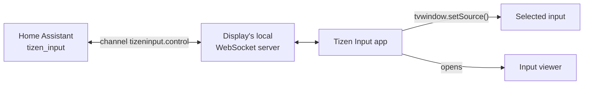

# Tizen Input

Switch Samsung Tizen display inputs locally from Home Assistant, including
DisplayPort, with live readback and no remote key emulation.

Samsung's local API only changes inputs through remote key presses, which
can't select DisplayPort on displays like the Odyssey G8, and SmartThings' cloud
API now needs a paid plan. Tizen Input is a small app on the display that
selects inputs through Tizen's TV window API and reports the current one back.
Its Home Assistant integration adds a media player with the display's power
and inputs, a signal sensor for each input, a Cycle button and, once paired, a
remote.

## How it works



The app runs hidden and opens the system input viewer after each switch, so the
input fills the screen. It checks the inputs every two seconds and pushes
changes to Home Assistant, including ones made with the remote. The channel needs
no pairing, and the integration only trusts state sent by the app.

## Requirements

- A Samsung Tizen display with developer mode. Tested on an Odyssey G8 OLED
  (G85SB, Tizen 6.5). Other Samsung TVs and Smart Monitors share the APIs but are
  untested.
- Tizen Studio or the Tizen CLI with the Samsung TV extensions and Certificate
  Extension, and a free Samsung account.
- Home Assistant 2025.3 or later.

## Install the app

> [!NOTE]
> The app can't go on Samsung's store, which expects apps to pause while hidden,
> so each display needs a build signed with its own Samsung certificate.

1. Enter `12345` in Apps, or on newer firmware the settings page inside Apps.
   Turn developer mode on with your computer's IP and restart the display.
2. Read the DUID with `sdb connect <display>:26101` and
   `sdb -s <display>:26101 shell 0 getduid`, then create a Samsung certificate
   profile for it ([Samsung's guide](https://developer.samsung.com/smarttv/develop/getting-started/setting-up-sdk/creating-certificates.html)).
3. Copy `.env.example` to `.env` and fill it in.
4. Run `scripts/build-app.sh`, then `scripts/install-app.sh`. The app opens on
   the display, and Return hides it.

## Install the integration

Add this repository to HACS as a custom Integration repository, or copy
`custom_components/tizen_input` into your configuration. Then add Tizen Input
under Settings > Devices & services with the display's address.

## Power control

Pairing lets the media player turn the display on and off, and adds a remote
whose `remote.send_command` presses Samsung keys such as `KEY_INFO`. With the
display on, submit the pairing step and select Allow on the display, or skip it
and pair later from Reconfigure. A display that loses the pairing asks again on
the next key press while it's on, and selecting Allow then pairs it again.

The media player turns the display on with KEY_POWER while it's on the network,
and with Wake-on-LAN once it has dropped off, which needs the display's Power On
with Mobile setting. The Odyssey G8 drops off 20 seconds to a few minutes after
turning off.

## Cycle

The Cycle button moves to the next input with a signal, by type then number. An
input only has a signal while its device sends video, so a PC that turns its
display off or a closed laptop lid loses it.

| Display | A press |
| --- | --- |
| Off | Turns it on, then acts as below without turning it off |
| On, another input has a signal | Selects the next one |
| On, only the current input has a signal | Turns it off |
| On, no input has a signal | Runs the default entity and selects the default input, or turns it off when neither is set |

Without power control, a press only switches inputs. The defaults are set in the
integration's options.

## Limitations

- Some inputs can't be read back. On the Odyssey G8, USB-C (HDMI 2) shows as
  unknown until the integration has selected it once.
- The app doesn't start when the display boots, and the signal sensors are
  unavailable until it does. The first selection or Cycle press launches it,
  which took about 7 seconds after a cold boot on the Odyssey G8.

## Channel protocol

Clients join `ws://<display>:8001/api/v2/channels/tizeninput.control?name=<base64 name>`
and send `{"method": "ms.channel.emit", "params": {"event": ..., "data": ..., "to": "host"}}`.
The app replies to `"broadcast"`.

| Event | Direction | Data |
| --- | --- | --- |
| `source.set` | to app | `{type, number}` |
| `source.get` | to app | none |
| `source.list` | both | The reply is `[{type, number, name, connected}]`. Also sent when the list changes |
| `source.state` | from app | `{type, number, signal}`, or `null` when unreadable. Sent after `source.get`, 3 seconds after `source.set`, and on any change |

## Development

```sh
uv run pytest       # channel client, power control and Cycle decisions
npm ci && npm test  # app, with mocked Tizen APIs
```

To debug on the display, stop the app with
`sdb -s <display>:26101 shell 0 was_kill TizenInput.TizenInput`, start
`shell 0 debug TizenInput.TizenInput` the same way, and open
`http://<display>:<printed port>/json`.
